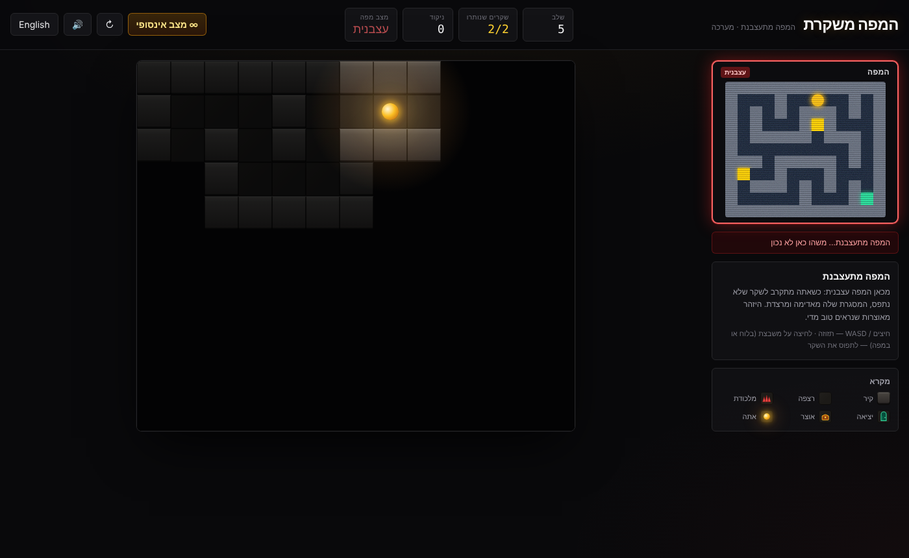

# המפה משקרת · The Map Lies

**The map always lies. The only question is about what.**

A 2D grid-based puzzle-stealth game. You crawl through a pitch-black dungeon with a lantern that lights only the 3×3 tiles around you, guided by a minimap in the corner. The catch is that **the minimap always lies**. Every level hides one or more deliberate discrepancies between the map and reality. To get through, you compare what your lantern shows with what the map claims, then **call out the lie** (לתפוס את השקר).



The UI is in Hebrew by default (RTL), and you choose Hebrew or English on the start screen (you can switch any time from the top bar).

**▶ Play:** https://yakov-ashgar27.github.io/the-map-lies/

### Install it like an app

The game is a Progressive Web App, so it installs like a regular app and works offline.

- **Windows / Mac (Chrome or Edge):** open the link and click **📲 התקנה כאפליקציה** in the top bar, or the install icon in the address bar. The game gets its own window and a shortcut on the desktop and in the Start menu.
- **Android:** open the link in Chrome, then use the menu ⋮ → **Install app** (or **Add to Home screen**).
- **iPhone / iPad:** open the link in Safari, then Share → **Add to Home Screen**.

---

## How this was built (transparency)

I built this game with **Claude Code** (Anthropic) as an AI pair-programmer. Every commit it helped write carries a `Co-Authored-By: Claude` line. The idea, a stealth puzzle where the map itself is the unreliable narrator, and the game design are mine: the lie types, the scoring, the "angry map" mechanic and the rule that a level never forces you to guess. I also playtested every change and decided what came next.

**Where to look in the code:**
- [`src/utils/levelGenerator.ts`](src/utils/levelGenerator.ts): a seeded procedural generator (maze carving, loops, rooms, lie injection).
- [`scripts/verify-generator.ts`](scripts/verify-generator.ts) (`npm test`): checks the campaign plus 500 generated levels (100 levels × 5 seeds) to prove that each one is solvable and that every lie can be detected without guessing.
- [`src/hooks/useGame.ts`](src/hooks/useGame.ts): the game state and the logic for calling out a lie.

## How to play

| Action | Control |
| --- | --- |
| Move | Arrow keys or **WASD** (works on any keyboard layout, Hebrew included) |
| Call out a lie | **Click a tile**, either on the main board or on the minimap |
| Restart level | **R** or the ↻ button |
| Continue / retry in dialogs | **Enter** / **Space** |
| Jump to endless mode | **∞ מצב אינסופי** button |
| Touch devices | On-screen D-pad |

### Rules

- **Fog of war:** you see only your tile and the 8 tiles around it. Tiles you have already seen stay dimly visible. Tiles you haven't seen are black.
- **The minimap** shows the whole level: walls, floors, traps, the exit and treasure. It is wrong about specific tiles.
- **Catching a lie:** once your lantern has shown you a tile that doesn't match the map, click it.
  - ✔ Correct: **+250**. Catching *every* lie in the level gives a bonus of **+300 per lie**, plays a fanfare, **lifts the fog of war** for the whole level, and makes the minimap "confess" by correcting itself.
  - ✘ Wrong (the tile is not a lie): **−50**, plus a shake.
  - You can't accuse a tile you've never seen. There's no penalty for trying; the game just tells you.
- **Traps** kill you and restart the level (**−100**). Honest traps are shown on the map. Disguised ones are not.
- **Treasure:** +100. **Exit:** +200. You can leave without catching every lie, but you miss the bonus. The win screen shows which lies you missed.

### Types of lies

| Lie | The map says | Reality |
| --- | --- | --- |
| **Phantom Wall** (קיר רפאים) | Wall | Open floor, often a hidden shortcut |
| **Illusion Floor** (רצפת אשליה) | Open path | Solid wall (dead end) |
| **Disguised Trap** (מלכודת מוסווית) | Safe floor, or a juicy treasure chest | Lethal spike trap |
| **Fake Exit** (יציאה מזויפת) | Exit in room A | Floor in A; the real exit is in room B (shown as plain floor on the map) |
| **Relocated Treasure** (אוצר שהוזז) | Chest in room A | The real chest is in room B |

For a relocation lie, clicking **either** the fake spot or the real spot catches it.

### Progression

- **Levels 1–5: hand-crafted campaign.** Each level introduces one mechanic. Levels 1–3 have 1 lie each; levels 4–5 have 2.
- **Levels 6+: infinite procedural mode.** The grid grows from 12×12 up to 20×20. Levels 6–8 have 2 lies, levels 9–13 have 2–3, and levels 14+ have 3.
- **The Angry Map (level 5+):** when you are within 2 tiles of an uncaught lie, the minimap gets nervous. Its border pulses red, the picture glitches with CRT static, and a quiet static crackle plays. It tells you *something* nearby is wrong, but never *what* or *where*.

Deep links for practice: `?level=5` starts at a given level, and `?seed=1234` fixes the endless-mode seed.

---

## The procedural generator and the zero-guessing validator

Source: [`src/utils/levelGenerator.ts`](src/utils/levelGenerator.ts)

Each procedural level comes from a seeded PRNG (`mulberry32`), so a given `(runSeed, level)` pair always produces the same dungeon. One generation attempt works like this:

1. **Maze carving:** an iterative *Recursive Backtracker* runs on odd coordinates.
2. **Loops and rooms:** about 10% of "connector" walls (a wall with open floor on two opposite sides) are knocked out, so the maze has loops and not just dead ends. Then 1–3 small rooms (3×3 up to 5×5) are carved. On even-sized grids, a few dead-end nubs grow into the spare border column and row.
3. **Placement:** the start goes in the top-left corner. The exit goes on the safe tile **farthest** from the start (by BFS). 1–2 treasure chests go in dead ends. A few honest traps are added, but only where they never block the exit or a chest.
4. **Lie injection:** `N` lies are drawn from the pool. Each lie cell stays at least 2 tiles from every other lie cell and at least 3 tiles from the start.
   - *Phantom Wall:* the generator opens a real connector wall in the truth grid and keeps it as a wall on the map.
   - *Illusion Floor:* the generator paints a fake shortcut or corridor extension on the map, while the truth stays a wall.
   - *Disguised Trap:* the generator turns a floor tile into a trap, but only if the exit and every chest stay reachable. The map shows that tile as floor, or 35% of the time as bait treasure.
   - *Relocated Exit / Treasure:* the map moves the item to a far-away decoy floor tile, often a dead end, and shows its real tile as floor.
5. **Validation:** the attempt is accepted only if it passes `validateLevel()`. Otherwise the generator retries with the next derived seed. If 40 attempts fail, it sweeps through fixed seeds, and as a last resort it falls back to a hand-crafted level. In practice, no level has ever needed more than 3 attempts.

### Validator invariants (`validateLevel`)

All checks run BFS on the **true** grid, where a tile is safe if it is floor, exit or treasure (not a trap or wall):

- **R1 Reachability:** a 100% trap-free path exists from the start to the real exit. The true grid has exactly one exit, and so does the map.
- **R2 Observability:** every lie cell lies inside the 3×3 lantern of at least one safe tile reachable from the start. No lie can be impossible to see.
- **R3 No blind-step traps:** every trap, honest or disguised, has a reachable safe 4-neighbour. Because you can only move to an adjacent tile, and adjacent tiles are always lit, you always see a trap one step before you could stand on it. R1 also guarantees that no trap is ever a forced choke point.
- **R4 Deductive consistency:** every lie produces a contradiction you can actually see.
  - A Phantom Wall is itself reachable open floor.
  - An Illusion Floor sits next to a reachable tile where the map promises the path continues, and the lantern shows solid stone there instead.
  - A Disguised Trap can be seen from a reachable safe tile.
  - For a Relocation, both the decoy spot and the real spot are reachable.
- **R5 Bookkeeping:** the map and the truth differ *only* at declared lie cells (no accidental lies), no cell belongs to two lies, the start tile is honest, and the lie count matches the difficulty.

The same validator runs on the five hand-crafted campaign levels.

### Verification

```bash
npm run verify
```

[`scripts/verify-generator.ts`](scripts/verify-generator.ts) does the following:

- Validates all 5 campaign levels.
- Generates **100 consecutive levels (6→105) for 5 different run seeds** (500 levels in total). It checks that every level passes the validator, has the right grid size and lie count, and needs no fallback. It also measures generation time: about 0.5 ms on average, under 10 ms in the worst case.
- Feeds the validator deliberately broken levels (a choke-point trap, an undeclared discrepancy, a sealed-off lie) and checks that it **rejects** each one.
- Checks that generation is deterministic.
- Checks the game rules: a disguised trap kills, a wrong call is penalised, catching every lie lifts the fog, unseen tiles can't be accused, and the angry map triggers within 2 tiles.

---

## Tech stack

- **React 19 + TypeScript + Vite**
- **Tailwind CSS v4** (via `@tailwindcss/vite`), plus custom CSS for the lantern glow, CRT scanlines, glitch and static effects
- **Web Audio API** for all sound effects (footsteps, bumps, the lie-caught arpeggio, the full-reveal fanfare, wrong-call buzz, trap death, level complete, angry-map static). They are synthesized on the fly, with no audio files.
- **PWA:** a web manifest, icons and a service worker (`public/sw.js`) make it installable and playable offline.
- **GitHub Actions** (`.github/workflows/deploy.yml`) runs `npm run verify` and `npm run build` on every push to `main`, then deploys to GitHub Pages.
- No runtime dependencies besides React.

```
src/
├── types/game.ts            # data model: Tile, Lie, Level, GameState, events
├── levels/
│   ├── parse.ts             # ASCII level format (one picture = truth + map + lies)
│   └── campaign.ts          # levels 1–5
├── utils/
│   ├── levelGenerator.ts    # procedural generator + zero-guessing validator
│   ├── gameLogic.ts         # pure rules: move, callLie, fog, angry map, scoring
│   ├── grid.ts              # BFS and grid helpers
│   └── rng.ts               # seeded PRNG
├── hooks/
│   ├── useGame.ts           # reducer: levels, endless mode, retry
│   └── useAudio.ts          # Web Audio synth SFX
├── components/              # GameBoard, Minimap, Hud, Overlay, TileIcon
├── i18n.ts                  # Hebrew / English strings
└── App.tsx
```

## Run locally

```bash
npm install
npm run dev       # http://localhost:5173
npm run build     # type-check + production build into dist/
npm run verify    # generator / rules verification
```

## License

MIT
